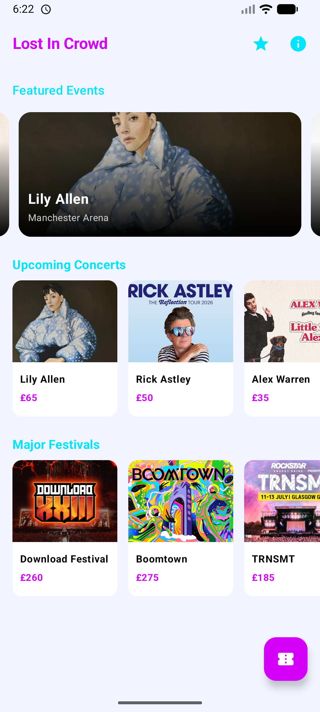
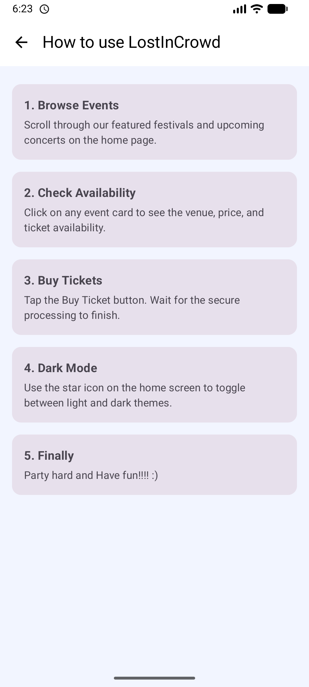
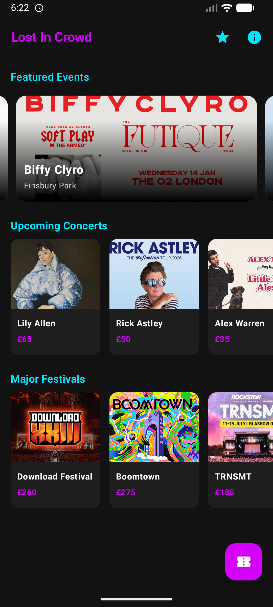

# Mobile App Project — LostInCrowd

## Overview
**Lost In Crowd** is a complete redesign and expansion of the **Concert Ticket App** starter lab. While the original lab provided basic functionality,This project transforms it into a modern concert and festivals booking application.Its is Built entirely using modern Jetpack Compose,The app addresses the common frustration of a generic interfaces by providing a fluid, animated, and user-centric experience.
The app addresses the need for a modern, responsive booking experience. It enhances the original concept by introducing:
- **Complex State Management:** Replaced simple counters with a robust MVVM architecture using StateFlow.
- **Modern UI Interface:** While the original version of this app was just a simple list.This redesign fixes that by making the app look modern, fun, and easy to use.
- **Realistic Simulation:** The ticket purchases now include realistic delays, similar to what users experience on live networks.

--- 

## AI assistance
This project is my own original work. I utilized AI tools (e.g., chatgpt) selectively to assist with specific code syntax and development commands. All AI-generated content was critically reviewed, tested, and executed manually.
AI assistance was specifically used for the following areas:
- In designing the Coroutine scope and simulated network delay logic to prevent UI freezing.
- In retrieving the specific Kotlin syntax/commands needed to implement some of my concept,like simulating  ticket availability using random function.
- In identifying commands to resolve Gradle namespace errors.
- In configuring NavHost to correctly pass event IDs between screens.
- In implementing specific Jetpack Compose Modifier chains to achieve the desired UI layout and alignment.

---

## Features
- The app has a fresh look with a Spotlight section that shows featured events,It also has 2 other sections which show the upcoming concerts and major festivals.
- A Visual feedback which shows Availability of seats.Besides that you can choose how many tickets to buy,and the price updates automatically.
- A dedicated screen where users can view and delete purchased tickets.
- **Theme Personalization**:
   - [ ] **Day Mode**: White Lavender & Purple theme
   - [ ] **Night Mode**: Neon Cyan & Magenta theme
- Implemented background processing,When you click "Buy," the app waits 2 seconds simulating a network connection.
- Added a "Help" screen to guide first-time users.

---

## Architecture & Design

The application is built using the MVVM (Model-View-ViewModel) architectural pattern.Which ensures a clean separation between the user interface and the code logic, making the app easier to test and maintain.

- **Architecture Pattern:** MVVM (Model-View-ViewModel)
### Key Components
  - MainActivity.kt (UI Entry Point):
    - Acts as the main container for the app.
    - Hosts the NavHost, which manages navigation between the *Opening*, *Homescreen*, *details*, and *Tickets* screens.
  - AppView.kt (ViewModel):
    - The "brain" of the application.
    - Manages the state of the UI (e.g., isDarkTheme,isProcessing,ticketList) using reactive StateFlow. 
    - Handles user interactions and logic, such as calculating ticket prices and processing purchases.
  - EventRepository.kt (Model/Data Layer):
    - Serves as the one reliable place for all data.
    - Provides static lists of MusicEvent objects (Concerts and Festivals) to the rest of the app.
  - ui/theme/screens/ (View Layer):
    - Contains the Jetpack Compose screens (e.g., HomeScreen.kt, DetailScreen.kt.... etc.).
    - These screens are designed to be stateless when possible,relying solely on the ViewModel for the data they display

### Concurrency & Background Processing
  - To keep the app responsive, we do not perform heavy tasks on the main UI thread.
     - Coroutines: We use Kotlin Coroutines to handle simulated network tasks.
     - ViewModel:  When a user buys a ticket, a coroutine is launched,It simulates a 2-second network delay (using delay(2000)) to mimic a real API call. This prevents the UI from freezing.

### Architecture Diagram
....
| Diagram       | 
|-------------------------------|
|  | 

---

## UI / UX Design
The user interface was redesigned to feel like a real music festival application that is energetic, colorful, and easy to use.

### Color Scheme & Theme
  - **Light Mode:** Uses Soft white-Lavender and Deep Purple. It is designed to be clean and easy to read during the day.
  - **Dark Mode:** Uses a black background with Neon Cyan and Magenta accents.This should reduces eye strain.

### Responsiveness
  - The app uses Jetpack Compose lists (LazyColumn and LazyRow).Which was used to make sure the app looks good on both small phones and larger screens because the content scrolls.

### Accessibility
  - All buttons and icons have contentDescription labels.
  - Text colors were chosen to ensure they are readable against the background.

### App Screenshots:
| Home Screen(Light Mode)       | Help Screen | Dark Mode |
|-------------------------------|-------------|-----------|
|  |  || 

---

## How to Build & Run

1. **Clone the Repository:**
    Open your terminal and run:
    ```bash
    git clone `git clone git@github.com:UniOfGreenwich/expansion-redesign-app-AbishilS.git>`
2. **Open in Android Studio:**
  - Open Android Studio (Giraffe or newer).
  - Select **"Open"** and find the folder you just cloned.
3. **Sync Gradle:**
  - Wait for the "Sync" to finish.
4. **Run the App:**
  - Connect your Android phone via USB or start an Emulator.
  - Click the green Run button
---

## Technologies Used

- **Kotlin**: The main programming language.
- **Jetpack Compose**: For building the UI (User Interface).
- **Kotlin Coroutines**: For background tasks (multithreading).
- **StateFlow**: To manage data updates automatically.
- **Navigation Compose**: To move between screens.
---

## Multithreading / Background Tasks

This section explains how the app uses **Multithreading** (a key requirement of the assignment).

### The Problem
If we download data or calculate prices on the main screen, the app will freeze and look broken.

### The Solution
When you click Buy Ticket:
1.  The app starts a background task (Coroutine) using `viewModelScope.launch`.
2.  It waits for 2 seconds (`delay(2000)`) to simulate connecting to a server.
3.  During this time, the "Buy" button changes to a **loading spinner** so the user knows something is happening.
4.  Once finished, it updates the ticket list and changes the screen.

-Why this Helps
--This keeps the app smooth and prevents Application Not Responding (ANR) errors.

## References
- **Android Developers.** (2025). *Jetpack Compose Documentation*. [Online]. Available at: https://developer.android.com/jetpack/compose
- **Android Developers.** (2025). *Guide to App Architecture*. [Online]. Available at: https://developer.android.com/topic/architecture
- **OpenAI.** (2025). *ChatGPT*. Used for debugging and syntax help.
- **Native Mobile Bits (2023)**. Building a Complete Android App : Jetpack Compose, MVVM, Coroutines & Dependency Injection. [online] YouTube. Available at: https://www.youtube.com/watch?v=LFlobqW8Sy8.

---
## Licence

[Educational Community License 2.0 [ECL]](./LICENSE.md)

## Author 

* **Name:** Abhishil Sinoj
* **GitHub:** https://github.com/AbishilS

---

## Future Improvements

- [ ] To implement a local database so that purchased tickets and availability changes are saved even after the app is closed.
- [ ] To automatically generate a unique QR code for each ticket upon purchase, which could be scanned for entry at the event.
- [ ] To ensure that buying a ticket automatically subtracts it from the total availability in the system, preventing overbooking.
- [ ] To allow users to select a specific seat selection (e.g., Row R, Seat 7) on a visual map, allowing users to buy tickets based on their preferred position.
- [ ] TO add a search bar to allow users to quickly find specific artists, venues, or genres.
